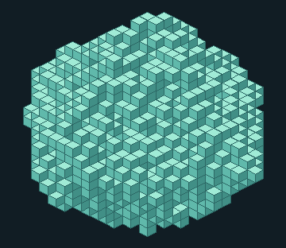

# MarkovJunior in Rust

This is an in-progress Rust port of the MarkovJunior interpreter.

| 2D · top view | 3D · isometric view |
| :---: | :---: |
|  |  |

Both animations run `models/VoxelGrowth.xml` from a single occupied cell for
14 steps with seed `7`. On each step, an empty cell with one or two occupied
face neighbors has a 65% chance to fill. The only change between runs is the
depth: `1` on the left, `31` on the right.

The current engine supports two-dimensional grids, literal, wildcard, and
union-symbol rules, the default square symmetries, and `one`, `all`, `prl`,
`sequence`, `markov`, `path`, and 2D `convolution` nodes. It loads one model XML
file, runs a seeded simulation, and prints the final grid as text.

The `symmetry` attribute accepts `()`, `(x)`, `(y)`, `(x)(y)`, `(xy+)`, and
`(xy)`. Child rules can override their parent node's symmetry group.

Declare a union inside a `sequence` or `markov` node. For example,
`<union symbol="X" values="BW"/>` makes input symbol `X` match `B` or `W`.

3D grids support `convolution` with `VonNeumann` (face neighbors) or
`NoCorners` (faces and edges), alone or inside `sequence` and `markov`.
3D pattern rewrites and paths are not yet supported. Other missing features
include inference, fields, map nodes, convchain, WFC, image or voxel rule
inputs, graphical rendering, and the upstream multi-model runner.

## Run

```sh
cargo run --locked -- models/VoxelGrowth.xml --width 31 --height 31 --depth 31 --steps 14 --seed 7 --vox growth.vox
```

Open `growth.vox` in MagicaVoxel. Choose a new output filename for each run;
the CLI does not overwrite existing files. The first symbol in `values` is
empty space; the remaining symbols use consecutive default palette entries.
VOX output supports up to 256 cells on each axis. Omit `--vox` for text output.
Defaults are width `64`, height `64`, depth `1` (2D), steps `10000`, and seed `0`.

## Code layout

- `grid.rs` owns grid state and symbols.
- `rule.rs` parses patterns, expands symmetries, finds matches, and applies rules.
- `node.rs` runs rule nodes and branch nodes.
- `path.rs` finds and paints grid paths.
- `convolution.rs` applies local-neighbor count rules.
- `model.rs` loads XML and exposes the simulation API.
- `main.rs` provides the text-output CLI.