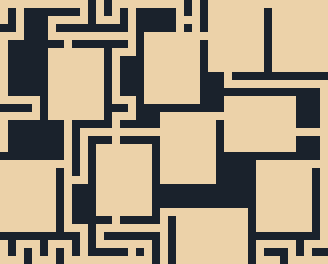
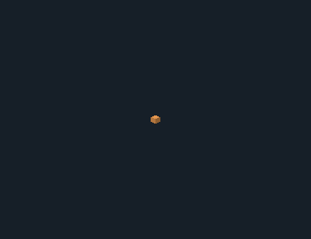
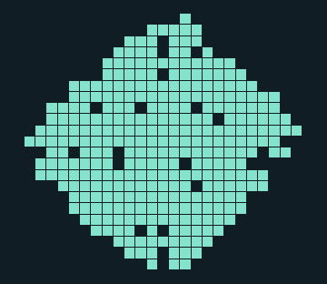

# MarkovJunior in Rust

This Rust port of [MarkovJunior](https://github.com/mxgmn/MarkovJunior) generates maps by repeatedly replacing patterns on a grid. The animations below show the Rust interpreter running the linked XML models.

## From rules to maps

| [Backtracking maze](models/MazeBacktracker.xml) | [Dungeon rooms](models/BasicDungeonGrowth.xml) | [Cave](models/Cave.xml) |
| :---: | :---: | :---: |
|  |  |  |

**Maze.** Two rules drive the orange cell. `RBB → GGR` advances it two spaces into untouched ground, leaving a green trail. When it cannot advance, `RGG → WWR` walks it back along that trail and marks the finished passage white. Rotations let the same rules carve in all four directions.

**Dungeon.** A room template attaches to an open doorway. Once no more rooms fit, cleanup rules turn temporary markers into floor and open walls between adjacent rooms.

**Cave.** The generator scatters noise, then each cell counts its eight neighbors. Dense patches survive while isolated squares disappear; a final rule cleans up diagonal contacts.

## Combining rulenodes

A `<sequence>` runs its children in order: once a stage finishes, the next one takes over its grid. A `<markov>` checks its children from the top on each turn, so a later rule can make an earlier one applicable again.

| [River](models/River.xml) | [Flowers](models/Flowers.xml) | [Rooms and mazes](models/NystromDungeon.xml) |
| :---: | :---: | :---: |
|  |  |  |

**River — build in stages.** Two seeds compete for space. The next stage turns their shared border into water and clears the rest of the grid. Grass spreads from the banks while forests expand from scattered seeds.

**Flowers — return to an earlier rule.** The first child of a `<markov>` grows, branches, or blooms an existing shoot. Only when none of those moves fits does the second child plant a new shoot. On the next turn the growth rules get first chance again.

**Rooms and mazes — nest the two.** A sequence places rooms and uses a Markov node to carve corridors in the gaps. A second Markov node marks reachable floor; when marking stalls, it opens a wall into a new region and resumes marking. The final stages add loops and trim dead ends.

Run River as text, or generate six new gallery GIFs (41 × 33 cells):

```sh
cargo run --locked -- models/River.xml --width 41 --height 33
cargo run --locked --example gallery -- assets
```

The CLI and both galleries pick a fresh seed on each run and print it to stderr. Append `--seed N` to replay a result with the same model and dimensions. The images here are saved samples, not live renders. Gallery commands replace their output files; choose another directory instead of `assets` to keep a variation.

Seeds for the samples shown here: `1414196453300954813` for `gallery`, `7712408619116528968` for `voxel_gallery` (including the growth pair).

These six XML models are from [Maxim Gumin’s original collection](https://github.com/mxgmn/MarkovJunior/tree/42aaf24bcf54ae164fba49c0a59348297904a676/models) ([MIT license](LICENSE)). The gallery uses local copies; no upstream checkout is needed.

## Voxel structures

| [Building growth](models/Courtyard.xml) | [Cubic lattice maze](models/FrameCube.xml) | [Terraced island](models/TerracedIsland.xml) |
| :---: | :---: | :---: |
|  |  |  |
| [Building .vox](assets/courtyard.vox) | [Cube .vox](assets/frame-cube.vox) | [Island .vox](assets/terraced-island.vox) |

These three are **local rule models written for this port**, not reproductions of specific upstream buildings or landscapes. None takes a floor plan, skeleton, or height map as input.

**Building.** A single bay starts the process. An exposed wall beside enough empty space can grow a room or a longer hall; that rewrite opens the doorway and creates new attachment sites. A roof can become a terrace or support another storey. The room shapes are authored; the floor plan and roofline are not. Below: the same XML, dimensions, camera and palette, ten consecutive seeds in reading order.


**Cube.** From a single joint, `J.. → JFJ` (and its vertical equivalents) adds a strut and a new joint. The endpoint must be vacant, so a move cannot close a loop. The grid fixes the cubic envelope; the rules generate the routes inside it.

**Island.** One rock spreads into adjacent water. Higher rock can only appear above a supported patch of lower rock; narrow shores therefore rise less than broad interiors. Grass, sand and vegetation are added after the relief exists.

Open the `.vox` files in MagicaVoxel to inspect the structures from any angle. The animations show sampled interpreter states in execution order, not slices of a finished model. To regenerate the three colored models, their previews and the ten-building comparison:

```sh
cargo run --locked --example voxel_gallery -- assets
```

## The same growth rule in 2D and 3D

| 2D · top view | 3D · isometric view |
| :---: | :---: |
|  |  |

Both animations run `models/VoxelGrowth.xml` from a single occupied cell for
up to 14 steps using the same run seed. The voxel gallery regenerates this pair along with the structures. On each step, an empty cell with one or two occupied
face neighbors has a 65% chance to fill. The only change between runs is the
depth: `1` on the left, `31` on the right.

The current engine supports two-dimensional grids, literal, wildcard, and
union-symbol rules, the default square symmetries, and `one`, `all`, `prl`,
`sequence`, `markov`, `path`, and 2D `convolution` nodes. It loads one model XML
file, runs a seeded simulation, and prints the final grid as text.

The `symmetry` attribute accepts `()`, `(x)`, `(y)`, `(x)(y)`, `(xy+)`, and
`(xy)`. Child rules can override their parent node's symmetry group.

Declare a union inside a `sequence` or `markov` node. For example,
`<union symbol="X" values="BW"/>` makes input symbol `X` match `B` or `W`.

3D grids support `convolution` with `VonNeumann` (face neighbors) or
`NoCorners` (faces and edges), alone or inside `sequence` and `markov`.
For footprint-based models, a top-level 2D `sequence` can end with a `<map scale="1 1 N">` whose inline rules replace a single cell with a vertical column. Output layers are written top to bottom; `*` leaves a layer unchanged.
3D `one`, `all`, and `prl` rewrite patterns accept explicit `()` or `(xy)` symmetry, including inherited declarations. Spaces separate layers (top first); `/` separates rows. Full cube symmetry and 3D paths are not yet supported. Other missing features
include inference, fields, general map nodes, convchain, WFC, image or voxel rule
inputs, graphical rendering, and the upstream multi-model runner.

## Run

```sh
cargo run --locked -- models/VoxelGrowth.xml --width 31 --height 31 --depth 31 --steps 14 --vox growth.vox
```

Open `growth.vox` in MagicaVoxel. Choose a new output filename for each run;
the CLI does not overwrite existing files. The first symbol in `values` is
empty space; the remaining symbols use consecutive default palette entries.
VOX output supports up to 256 cells on each axis. Omit `--vox` for text output.
Defaults are width `64`, height `64`, depth `1` (2D), and steps `10000`. Seed `0` is a valid explicit replay seed.

## Code layout

- `grid.rs` owns grid state and symbols.
- `rule.rs` parses patterns, expands symmetries, finds matches, and applies rules.
- `node.rs` runs rule nodes and branch nodes.
- `path.rs` finds and paints grid paths.
- `convolution.rs` applies local-neighbor count rules.
- `model.rs` loads XML and exposes the simulation API.
- `main.rs` provides the text-output CLI.