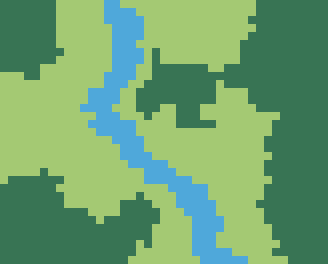

# MarkovJunior in Rust

This Rust port of [MarkovJunior](https://github.com/mxgmn/MarkovJunior) generates maps by repeatedly replacing patterns on a grid. The animations below show the Rust interpreter running the linked XML models.

## From rules to maps

| [Backtracking maze](models/MazeBacktracker.xml) | [Dungeon rooms](models/BasicDungeonGrowth.xml) | [Cave](models/Cave.xml) |
| :---: | :---: | :---: |
|  |  |  |

**Maze.** Two rules drive the orange cell. `RBB → GGR` advances it two spaces into untouched ground, leaving a green trail. When it cannot advance, `RGG → WWR` walks it back along that trail and marks the finished passage white. Rotations let the same rules carve in all four directions.

**Dungeon.** A room template attaches to an open doorway. Once no more rooms fit, cleanup rules turn temporary markers into floor and open walls between adjacent rooms.

**Cave.** The generator scatters noise, then each cell counts its eight neighbors. Dense patches survive while isolated squares disappear; a final rule cleans up diagonal contacts.

## Combining rulenodes

A `<sequence>` runs its children in order: once a stage finishes, the next one takes over its grid. A `<markov>` checks its children from the top on each turn, so a later rule can make an earlier one applicable again.

| [River](models/River.xml) | [Flowers](models/Flowers.xml) | [Rooms and mazes](models/NystromDungeon.xml) |
| :---: | :---: | :---: |
|  |  |  |

**River — build in stages.** Two seeds compete for space. The next stage turns their shared border into water and clears the rest of the grid. Grass spreads from the banks while forests expand from scattered seeds.

**Flowers — return to an earlier rule.** The first child of a `<markov>` grows, branches, or blooms an existing shoot. Only when none of those moves fits does the second child plant a new shoot. On the next turn the growth rules get first chance again.

**Rooms and mazes — nest the two.** A sequence places rooms and uses a Markov node to carve corridors in the gaps. A second Markov node marks reachable floor; when marking stalls, it opens a wall into a new region and resumes marking. The final stages add loops and trim dead ends.

Run River as text, or regenerate all six gallery GIFs (41 × 33 cells, seed `3` for River and `7` for the others):

```sh
cargo run --locked -- models/River.xml --width 41 --height 33 --seed 3
cargo run --locked --example gallery -- assets
```

These six XML models are from [Maxim Gumin’s original collection](https://github.com/mxgmn/MarkovJunior/tree/42aaf24bcf54ae164fba49c0a59348297904a676/models) ([MIT license](LICENSE)). The gallery uses local copies; no upstream checkout is needed.

## The same growth rule in 2D and 3D

| 2D · top view | 3D · isometric view |
| :---: | :---: |
|  |  |

Both animations run `models/VoxelGrowth.xml` from a single occupied cell for
14 steps with seed `7`. On each step, an empty cell with one or two occupied
face neighbors has a 65% chance to fill. The only change between runs is the
depth: `1` on the left, `31` on the right.

The current engine supports two-dimensional grids, literal, wildcard, and
union-symbol rules, the default square symmetries, and `one`, `all`, `prl`,
`sequence`, `markov`, `path`, and 2D `convolution` nodes. It loads one model XML
file, runs a seeded simulation, and prints the final grid as text.

The `symmetry` attribute accepts `()`, `(x)`, `(y)`, `(x)(y)`, `(xy+)`, and
`(xy)`. Child rules can override their parent node's symmetry group.

Declare a union inside a `sequence` or `markov` node. For example,
`<union symbol="X" values="BW"/>` makes input symbol `X` match `B` or `W`.

3D grids support `convolution` with `VonNeumann` (face neighbors) or
`NoCorners` (faces and edges), alone or inside `sequence` and `markov`.
3D pattern rewrites and paths are not yet supported. Other missing features
include inference, fields, map nodes, convchain, WFC, image or voxel rule
inputs, graphical rendering, and the upstream multi-model runner.

## Run

```sh
cargo run --locked -- models/VoxelGrowth.xml --width 31 --height 31 --depth 31 --steps 14 --seed 7 --vox growth.vox
```

Open `growth.vox` in MagicaVoxel. Choose a new output filename for each run;
the CLI does not overwrite existing files. The first symbol in `values` is
empty space; the remaining symbols use consecutive default palette entries.
VOX output supports up to 256 cells on each axis. Omit `--vox` for text output.
Defaults are width `64`, height `64`, depth `1` (2D), steps `10000`, and seed `0`.

## Code layout

- `grid.rs` owns grid state and symbols.
- `rule.rs` parses patterns, expands symmetries, finds matches, and applies rules.
- `node.rs` runs rule nodes and branch nodes.
- `path.rs` finds and paints grid paths.
- `convolution.rs` applies local-neighbor count rules.
- `model.rs` loads XML and exposes the simulation API.
- `main.rs` provides the text-output CLI.