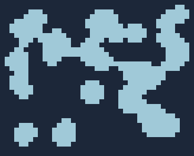
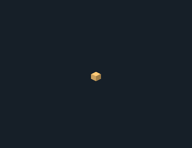
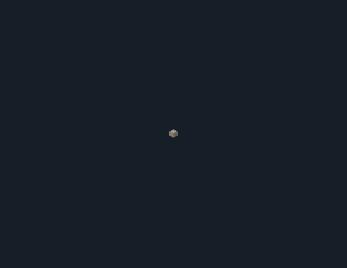
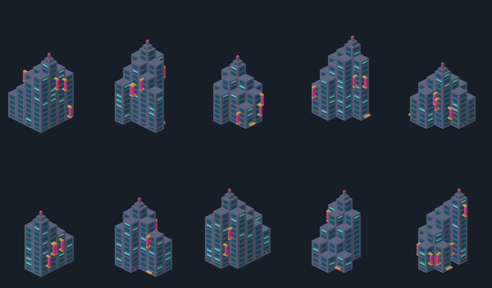

# MarkovJunior in Rust

This Rust port of [MarkovJunior](https://github.com/mxgmn/MarkovJunior) generates game levels and voxel structures by replacing grid patterns. The animations below show the Rust interpreter running each linked XML model.

## From rules to maps

| [Backtracking maze](models/MazeBacktracker.xml) | [Dungeon growth](models/BasicDungeonGrowth.xml) | [Connected caves](models/Cave.xml) |
| :---: | :---: | :---: |
|  |  |  |

**Maze.** Two rules drive the orange cell. `RBB → GGR` advances it two cells into uncarved ground and leaves a green trail. When it cannot advance, `RGG → WWR` walks back along that trail and marks the finished passage white. Rotations let the same rules carve in all four directions.

**Dungeon.** Varied room templates attach to open doorways, placing pillared halls, octagonal chambers, and junctions. A Markov path stage routes winding corridors between remaining doorways and trims dead-end stubs. Final rules frame the rooms in stone walls and mark doorway thresholds.

**Cave.** The generator scatters noise, then each cell counts its eight Moore neighbors to smooth natural caverns. A Markov node floods one chamber and carves path tunnels through rock until every pocket connects. Interior basins fill with water, and stone walls outline the floor.

## Combining rulenodes

A `<sequence>` runs its children in order. When one stage has no more matches, the next stage takes over the grid. A `<markov>` checks its children from the top on each turn, so a later rule can reactivate an earlier rule.

| [River valley](models/River.xml) | [Flowers](models/Flowers.xml) | [Rooms and mazes](models/NystromDungeon.xml) |
| :---: | :---: | :---: |
|  |  |  |

**River — build in stages.** Two seeds compete for space until they fill the grid. The next stage turns their shared boundary into water and lines both shores with sandy banks. Meadows spread from the sand while forests grow from inland seeds, and a wooden bridge spans the channel.

**Flowers — return to an earlier rule.** The first child of a `<markov>` grows, branches, or blooms an active shoot. The second child plants a new shoot only when no active shoot can advance. Final rules open rose blossoms on selected flower heads and add stem leaves.

**Rooms and mazes — nest the two.** A sequence places rooms of three sizes on a lattice and runs a Markov node to carve corridors. A second Markov node floods reachable floor and opens doorways into unreached regions whenever flooding stalls. The final stages add loop doorways, retract dead ends, and frame floors with stone walls.

Run River as text, or generate six gallery GIFs (`57 × 45` cells):

```sh
cargo run --locked -- models/River.xml --width 57 --height 45
cargo run --locked --example gallery -- assets
```

The CLI and both galleries pick a fresh seed on each run and print it to stderr. Append `--seed N` to replay a run with the same model and dimensions. The images here are saved samples from deterministic seeds. Gallery commands overwrite their output files, so pass another directory instead of `assets` to keep a variation.

Seeds for the samples shown here: `1414196453300954813` for `gallery`, and `7712408619116528968` for `voxel_gallery`.

These six models adapt patterns from [Maxim Gumin’s original collection](https://github.com/mxgmn/MarkovJunior/tree/42aaf24bcf54ae164fba49c0a59348297904a676/models) ([MIT license](LICENSE)). The gallery uses local XML files and requires no upstream checkout.

## Voxel structures

| [Cyberpunk high-rise](models/Courtyard.xml) | [Multi-level dungeon decks](models/FrameCube.xml) | [Terraced island](models/TerracedIsland.xml) |
| :---: | :---: | :---: |
|  |  |  |
| [Building .vox](assets/courtyard.vox) | [Dungeon .vox](assets/frame-cube.vox) | [Island .vox](assets/terraced-island.vox) |

These three rule models generate 3D game structures directly from a single seed voxel. None takes an authored floor plan, skeleton, or height map as input.

**High-rise.** Bays attach to one ground seed, and one bay becomes the core that grows one or two storeys per step. A neighboring bay rises only when it has a floor below and a taller neighbor beside it. Glass walls and steel floor plates assemble from the lobby upward, followed by neon signs and a rooftop beacon. Below: ten consecutive seeds on the same `25 × 25 × 54` grid, camera, and palette.



**Dungeon decks.** A 3D self-avoiding tree branches horizontally and vertically from the center hub without closing loops. Subsequent stages expand each joint into a `3 × 3` stone platform and widen horizontal links into parapet bridges. Vertical links become cyan lift shafts with four-post landings, and overhanging decks drop central support columns.

**Island.** One rock seed spreads across the water plane and smooths into coves and headlands. Higher rock layers form only over supported `3 × 3` bases, so broad interiors rise higher than narrow shores. Later stages add sandy beaches, grass turf, exposed cliff faces, a wooden pier, a watchtower, and 3D trees.

Open the `.vox` files in MagicaVoxel to inspect the structures from any angle. The animations show sampled interpreter states in execution order. Run the command below to regenerate the three `.vox` models, their animations, and the ten-building sheet:

```sh
cargo run --locked --example voxel_gallery -- assets
```

## The same growth rule in 2D and 3D

| 2D · top view | 3D · isometric view |
| :---: | :---: |
|  |  |

Both animations run `models/VoxelGrowth.xml` from one occupied cell for up to 14 steps with the same seed. The voxel gallery regenerates this pair alongside the three structures. On each step, an empty cell with one or two occupied face neighbors has a 65% chance to fill. Only the grid depth changes between the two runs: `1` on the left and `31` on the right.

The engine supports 2D and 3D grids, literal, wildcard, and union-symbol rules, and square symmetry subgroups. Supported nodes include `one`, `all`, `prl`, `sequence`, `markov`, 2D `path`, `convolution`, and terminal 1:1 column `map` nodes. The CLI loads one XML model, runs a seeded simulation, and outputs either text or MagicaVoxel `.vox` data.

The `symmetry` attribute accepts `()`, `(x)`, `(y)`, `(x)(y)`, `(xy+)`, and `(xy)`. Child rules can override the symmetry group of their parent node. Declare a union inside a `sequence` or `markov` node, such as `<union symbol="X" values="BW"/>`.

3D grids support `convolution` with `VonNeumann` (face neighbors) or `NoCorners` (faces and edges). Top-level 2D sequences can end with `<map scale="1 1 N">` to expand each cell into a vertical column. 3D `one`, `all`, and `prl` patterns require explicit `()` or `(xy)` symmetry, with spaces between top-to-bottom layers. Full cube symmetry, 3D paths, inference, fields, general map nodes, convchain, and WFC are not implemented.

## Run

```sh
cargo run --locked -- models/VoxelGrowth.xml --width 31 --height 31 --depth 31 --steps 14 --vox growth.vox
```

Open `growth.vox` in MagicaVoxel. Choose a new output filename for each run because the CLI does not overwrite existing files. The first symbol in `values` represents empty space, and remaining symbols use consecutive palette entries. VOX export supports up to 256 cells per axis, and omitting `--vox` prints text layers instead. Default dimensions are width `64`, height `64`, depth `1`, and steps `10000`.

## Code layout

- `grid.rs` owns grid state and symbols.
- `rule.rs` parses patterns, expands symmetries, finds matches, and applies rules.
- `node.rs` runs rule nodes and branch nodes.
- `path.rs` finds and paints grid paths.
- `convolution.rs` applies local-neighbor count rules.
- `column_map.rs` expands 2D cells into vertical voxel columns.
- `vox.rs` encodes 3D grids in MagicaVoxel format.
- `model.rs` loads XML and exposes the simulation API.
- `main.rs` provides the CLI.
